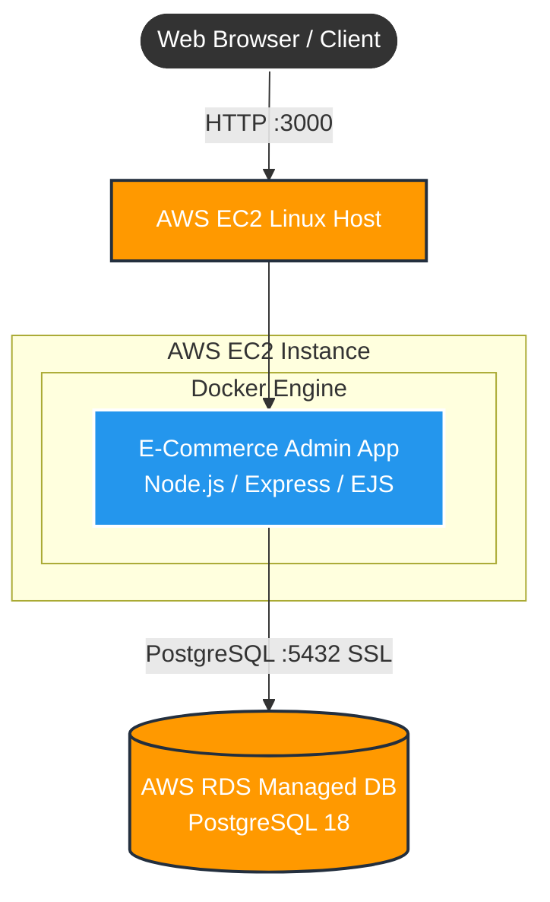

# Cloud & DevOps Capstone Project: E-Commerce Admin Panel

A containerized full-stack CRUD E-Commerce Admin Panel application engineered with Node.js, Express, and EJS, backed by a production AWS RDS PostgreSQL database, containerized using Docker, automated via GitHub Actions CI/CD workflows, and hosted on an AWS EC2 instance.

---

## 1. Project Overview

This capstone project implements an end-to-end cloud and DevOps architecture for an E-Commerce back-office administration platform. It enables administrators to manage inventories, create products, track stock thresholds, and perform live data updates with persistence on AWS RDS PostgreSQL.

### Key Highlights
- **Full CRUD Functionality**: Create, Read, Update, and Delete products with categories, SKUs, and pricing.
- **Managed Database Integration**: Direct connection with PostgreSQL engine on AWS RDS with SSL enforcement.
- **Containerization**: Standardized environments via multi-stage Docker builds and Docker Compose orchestration.
- **Continuous Integration (CI)**: Automated GitHub Actions pipeline validating dependencies and Docker image compilation on every commit.
- **Cloud Deployment**: Deployed on an AWS EC2 Linux compute host with continuous availability.
- **Operational Health**: `/health` endpoint configured for uptime monitoring and container probes.

---
## 2. Cloud Architecture



---

## 3. Tech Stack & Tools

| Component | Technology | Description |
| :--- | :--- | :--- |
| **Backend Runtime** | Node.js (v20) | JavaScript runtime environment |
| **Web Framework** | Express.js | REST routing and middleware handling |
| **Templating Engine** | EJS | Embedded JavaScript server-side templates |
| **Styling** | Tailwind CSS | Modern responsive admin UI layout |
| **Cloud Database** | AWS RDS (PostgreSQL) | Fully managed relational database |
| **Container Engine** | Docker / Compose | Multi-container application packaging |
| **CI/CD Automation** | GitHub Actions | Automated build, lint, and image test |
| **Cloud Compute** | AWS EC2 (t2.micro) | Linux cloud hosting infrastructure |
| **Version Control** | Git & GitHub | Distributed version control repository |

---

## 4. Repository Structure

```text
ecommerce-admin/
├── .github/
│   └── workflows/
│       └── deploy.yml              # CI/CD pipeline automation
├── src/
│   ├── config/
│   │   └── db.js                  # AWS RDS PostgreSQL connection pool
│   ├── controllers/
│   │   └── productController.js   # Product route handlers and actions
│   ├── models/
│   │   └── productModel.js        # Schema initialization and SQL queries
│   ├── routes/
│   │   └── productRoutes.js       # Express routes for CRUD operations
│   └── app.js                     # Main application entry point
├── views/
│   ├── partials/
│   │   ├── header.ejs             # Common navigation and styles
│   │   └── footer.ejs             # Common footer scripts
│   ├── index.ejs                  # Product listing inventory table
│   ├── new.ejs                    # Product creation form
│   └── edit.ejs                   # Product update form
├── .env.example                   # Environment configuration template
├── .gitignore                     # Git tracking exclusions
├── Dockerfile                     # Multi-stage production Dockerfile
├── docker-compose.yml             # Docker service definitions
├── package.json                   # Project dependencies and run scripts
└── README.md                      # Comprehensive project documentation
